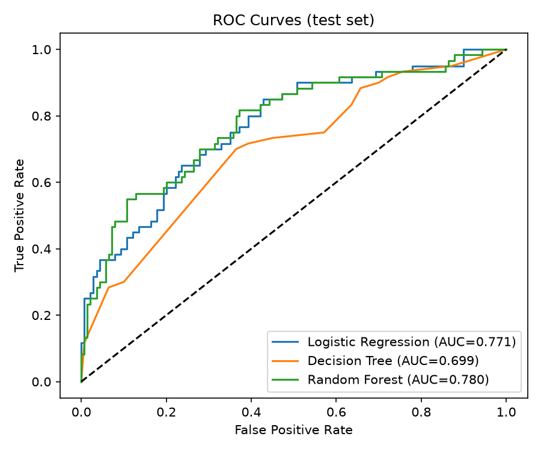
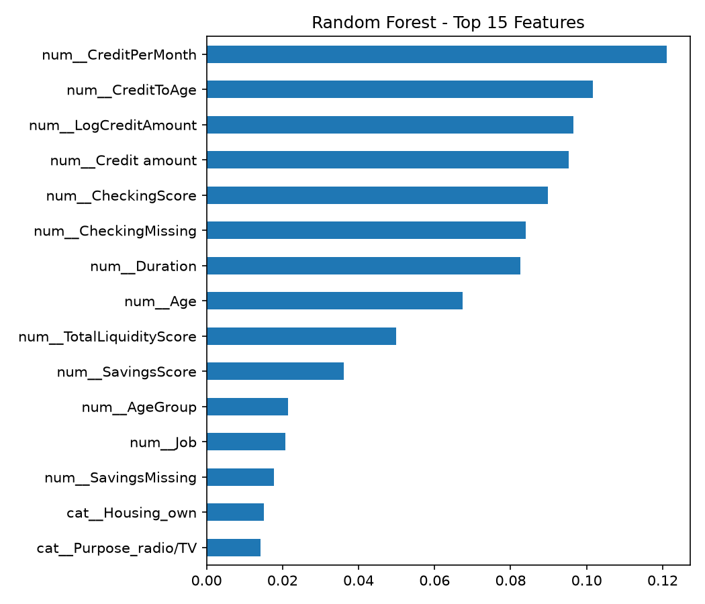

# Credit Scoring Model (German Credit Risk)

Predict whether a loan applicant is a **bad credit risk** using personal and loan information.

**Dataset:** Kaggle "German Credit Risk - With Target" (`german_credit_data.csv`, 1,000 rows)
https://www.kaggle.com/datasets/kabure/german-credit-data-with-risk

## Pipeline
1. Load data, target: `Risk` (bad = 1, good = 0)
2. Feature engineering: savings/checking scores and missing flags, liquidity score, credit per month, log credit, credit-to-age, long-loan flag, age group
3. Preprocessing in one sklearn pipeline: median imputation, scaling, one-hot encoding
4. Models: Logistic Regression, Decision Tree, Random Forest (`class_weight="balanced"`)
5. Evaluation: Precision, Recall, F1, ROC-AUC on a held-out 20% test set, plus 5-fold cross-validated ROC-AUC

## Run
```
pip install -r requirements.txt
# put german_credit_data.csv in data/
python src/train.py
```

## Results

| Model | Precision | Recall | F1 | ROC-AUC | CV ROC-AUC (5-fold) |
|---|---|---|---|---|---|
| Logistic Regression | 0.478 | 0.717 | 0.573 | 0.771 | 0.755 ± 0.019 |
| Decision Tree | 0.439 | 0.717 | 0.544 | 0.699 | 0.708 ± 0.053 |
| Random Forest | 0.506 | 0.667 | 0.576 | 0.780 | 0.755 ± 0.035 |




## Analysis
- Random Forest and Logistic Regression performed similarly (CV ROC-AUC 0.755).
  Logistic Regression is simpler and easier to interpret, which matters in credit decisions.
- Decision Tree performed worst and was the least stable across folds.
- All models use class_weight="balanced" because only 30% of applicants are bad risks.
  This raises recall (about 67-72% of bad borrowers caught) at the cost of precision (about 44-51%).
- In credit scoring, missing a bad borrower (false negative) is usually costlier than rejecting
  a good one, so recall is prioritized. The decision threshold can be tuned to fit business needs.
- Limitations: small dataset (1,000 rows), so results vary between splits.
